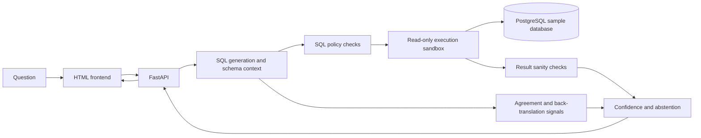
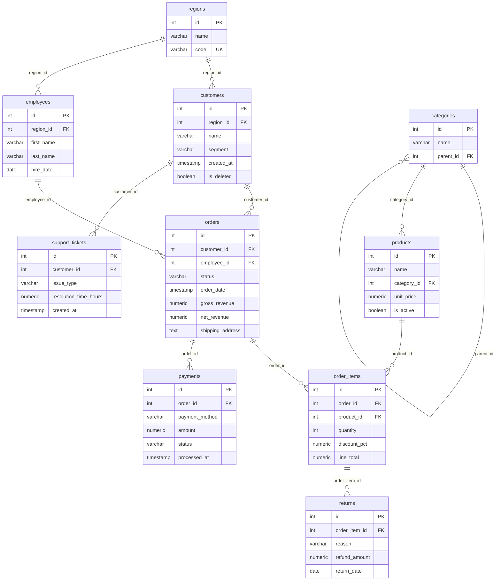

<p align="center">
  
</p>

<p align="center">
  <a href="https://github.com/chaithanyabs441-ux/text2sql-with-guardrails/actions/workflows/ci.yml"></a>
  
  
  
</p>

<h3 align="center">Ask questions in plain English. Inspect the SQL. Get results through a read-only database account.</h3>

SafeQuery AI is a **text-to-SQL system built around the question "should you trust this query?"**
Instead of generating SQL and running it blindly, every request passes through layered defenses:
an AST-based SQL policy, a read-only PostgreSQL role with a statement timeout, result sanity checks,
and a calibrated confidence score that decides whether to **answer**, **warn**, or **abstain**.

> **Scope:** an experimental project for learning, demos, and evaluation, run against a synthetic
> sample database. It is **not** a production security boundary. See
> [Limitations](#limitations-and-safety-boundaries).

---

## Table of contents

- [Features](#features)
- [How a request flows](#how-a-request-flows)
- [Quick start](#quick-start)
- [Configuration](#configuration)
- [Database schema](#database-schema)
- [Using the API](#using-the-api)
- [Query strategies](#query-strategies)
- [Defense layers](#defense-layers)
- [Evaluation and results](#evaluation-and-results)
- [Development](#development)
- [Limitations and safety boundaries](#limitations-and-safety-boundaries)
- [Repository map](#repository-map)
- [License](#license)

## Features

- **Fallout VideoGame/Series-themed web UI** with query history, example questions, result tables, and CSV download.
- **Schema-grounded SQL generation** using retrieved schema context, a business glossary, and examples.
- **AST-wide SQL policy** (via `sqlglot`): `SELECT`-only, single statement, table and function allowlists,
  sensitive-column blocking, join/subquery limits, tautology and cartesian-join detection, and forced `LIMIT` clamping.
- **Read-only execution sandbox**: separate PostgreSQL role, read-only transaction, 5 s `statement_timeout`.
- **Hallucination signals**: three-candidate result agreement, LLM back-translation similarity, self-reported
  confidence, schema coverage, and result sanity checks.
- **Calibrated answer / warn / abstain decisions** from a logistic model with thresholds chosen on out-of-fold predictions.
  Abstention hides the SQL and rows and offers alternative candidates instead.
- **Evaluation harness** for gold-query execution accuracy, confidence calibration, LLM red-teaming,
  and an offline SQL attack suite.
- **Provider-agnostic LLMs**: any OpenAI-compatible endpoint for generation and a separate judge model.

## How a request flows



1. The API retrieves relevant schema context (Sentence Transformers) and asks the generator for candidate SQL.
2. The policy engine parses and validates the SQL. **Rejected SQL never reaches the executor.**
3. The sandbox runs validated SQL in a read-only transaction with a timeout.
4. Three candidates at temperatures 0.0 / 0.3 / 0.7 are independently validated and executed to measure agreement.
5. A judge model back-translates the SQL into a question; similarity, agreement, sanity warnings, self-reported
   confidence, and schema coverage feed the calibrated model.
6. Thresholds choose `answer`, `warn`, or `abstain_with_alternatives`.

## Quick start

**Prerequisites:** Docker Desktop and API keys for an OpenAI-compatible provider
(defaults to [Groq](https://groq.com)).

```bash
# 1. Create your environment file
cp .env.example .env          # PowerShell: Copy-Item .env.example .env

# 2. Set GENERATOR_API_KEY and JUDGE_API_KEY in .env  (this file is git-ignored)

# 3. Build and start PostgreSQL, the API, and the frontend
docker compose up --build -d
```

| Service | URL |
| --- | --- |
| Frontend | <http://localhost:8501> |
| API docs (Swagger) | <http://localhost:8000/docs> |
| Health check | <http://localhost:8000/health> |
| PostgreSQL (host port) | `localhost:5433` |

Stop everything with `docker compose down`.

> **Heads up:** database init scripts only run when PostgreSQL first creates its data volume. If you have an
> older `pgdata` volume, the read-only role and sample schema won't be re-created. Run
> `docker compose down -v` to reset it (this deletes the local data).
>
> The first request downloads sentence-transformer weights, so it can be noticeably slower.

### Sample database

A synthetic business database (PostgreSQL schema `core`) with ten tables. Its full structure is in
[Database schema](#database-schema) below. A glossary in `src/t2s/schema/glossary.yaml` encodes business
definitions such as *revenue → `net_revenue`* and *customer → active, non-deleted customers*.

Try questions like:

- *Which five products have the highest unit prices?*
- *What is total revenue by region?*
- *How many pending orders are there per month?*

## Configuration

Settings are read from `.env` (see `.env.example`) via `src/t2s/config.py`.

| Variable | Default | Purpose |
| --- | --- | --- |
| `DATABASE_URL` | local Postgres (`:5433`) | Admin connection, used for schema introspection |
| `DATABASE_URL_READONLY` | local Postgres (`:5433`) | **Read-only role** used to execute generated SQL |
| `GENERATOR_BASE_URL` | `https://api.groq.com/openai/v1` | OpenAI-compatible endpoint for SQL generation |
| `GENERATOR_API_KEY` | – | Generator key (**required**) |
| `GENERATOR_MODEL` | `llama-3.3-70b-versatile` | Generator model |
| `JUDGE_BASE_URL` | `https://api.groq.com/openai/v1` | Endpoint for the judge / back-translation model |
| `JUDGE_API_KEY` | – | Judge key (**required**) |
| `JUDGE_MODEL` | `qwen-2.5-coder-32b` | Judge model (a different model family adds diversity) |
| `MAX_RETRIES` | `3` | Retry budget for LLM calls |
| `LOG_LEVEL` | `INFO` | Logging verbosity |

Docker Compose overrides the two database URLs to point at the `db` container.

## Database schema

The sample database lives in the PostgreSQL schema `core` (see `docker/init.sql`). Data is synthetic and
generated at startup, roughly: 3 regions, 7 categories, 100 products, 50 employees, 10,000 customers,
50,000 orders, ~150,000 order items, plus payments, returns, and 5,000 support tickets (`docker/eval_seed.sql`).

### Entity-relationship diagram



### Tables

| Table | Columns | Notes |
| --- | --- | --- |
| `regions` | `id` PK, `name`, `code` (unique) | Sales regions: North America, Europe, Asia Pacific |
| `categories` | `id` PK, `name`, `parent_id` → `categories.id` | Self-referencing hierarchy (e.g. Electronics → Laptops, Phones) |
| `products` | `id` PK, `name`, `category_id` → `categories.id`, `unit_price`, `is_active` | `is_active` marks products currently sold |
| `customers` | `id` PK, `region_id` → `regions.id`, `name`, `segment`, `created_at`, `is_deleted` | `segment` ∈ `enterprise`, `smb`, `consumer`. **Soft delete** via `is_deleted` |
| `employees` | `id` PK, `region_id` → `regions.id`, `first_name`, `last_name`, `hire_date` | `hire_date` is sometimes `NULL` |
| `orders` | `id` PK, `customer_id` → `customers.id`, `employee_id` → `employees.id`, `status`, `order_date`, `gross_revenue`, `net_revenue`, `shipping_address` | `status` ∈ `completed`, `pending`, `cancelled`, `returned`. `net_revenue` accounts for discounts and returns. `shipping_address` is **blocked by the SQL policy** |
| `order_items` | `id` PK, `order_id` → `orders.id`, `product_id` → `products.id`, `quantity`, `discount_pct`, `line_total` | `discount_pct` is often `NULL`/0 |
| `payments` | `id` PK, `order_id` → `orders.id`, `payment_method`, `amount`, `status`, `processed_at` | `status` ∈ `success`, `failed`, `refunded` |
| `returns` | `id` PK, `order_item_id` → `order_items.id`, `reason`, `refund_amount`, `return_date` | One row per returned line item |
| `support_tickets` | `id` PK, `customer_id` → `customers.id`, `issue_type`, `resolution_time_hours`, `created_at` | `resolution_time_hours` is often `NULL` (unresolved tickets) |

### Access model

- The application connects as **`t2s_readonly`** to run generated SQL. It has `USAGE` on schema `core` and
  `SELECT` only on its tables, with `default_transaction_read_only = on` and a 5 s `statement_timeout`.
- The admin role `t2s_user` is used for setup and schema introspection, never for generated queries.
- The SQL policy allowlists exactly the ten tables above, and rejects references to `orders.shipping_address`.
- To re-apply the read-only role to an existing database volume without recreating tables, run
  `docker/readonly_role.sql`; it is safe to rerun.

## Using the API

### `POST /v1/query`

```bash
curl -s http://localhost:8000/v1/query \
  -H "Content-Type: application/json" \
  -d '{"question": "Which five products have the highest unit prices?",
       "strategy": "schema_glossary"}'
```

Response fields:

| Field | Description |
| --- | --- |
| `sql` | The validated, row-limited SQL that was executed |
| `explanation` | Model explanation of the query |
| `data` | Result rows |
| `warnings` | Sanity-check and policy warnings |
| `confidence_score` | Calibrated probability that the result is correct |
| `confidence_signals` | Individual signals (agreement, back-translation similarity, …) |
| `back_translated_question` | The judge's reconstruction of the question from the SQL |
| `decision` | `answer`, `warn`, or `abstain_with_alternatives` |
| `alternatives` | Other candidate queries (populated on abstention) |
| `calibration_ready` | Whether fitted calibration coefficients and thresholds were loaded |

Other endpoints: `GET /v1/schema` (database schema), `GET /v1/history` (recent successful queries;
result rows are not retained), and `GET /health`.

If calibration artifacts are missing, the API falls back to conservative default thresholds and reports
`calibration_ready: false`.

## Query strategies

| Strategy | Context given to the model | Notes |
| --- | --- | --- |
| `schema_glossary` *(default)* | Schema + business glossary + examples | Best overall in the saved evaluation |
| `zero_shot` | Schema only | Baseline |
| `schema_glossary_selfcorrect` | Same as default | Retries after a database execution error |

All strategies share the same policy and read-only execution path. Self-correction only reacts to
execution errors; it cannot prove that a *successful* query is semantically correct.

## Defense layers

| Layer | What it does | Code |
| --- | --- | --- |
| **Schema grounding** | Limits the model's context to relevant tables and business definitions | `src/t2s/schema/` |
| **SQL policy engine** | Rejects non-`SELECT`, multi-statement, unapproved tables/functions, sensitive columns, tautologies, cartesian joins, excessive joins/subqueries; clamps `LIMIT`/`OFFSET` | `src/t2s/guardrails/` |
| **Read-only sandbox** | Dedicated Postgres role, read-only transaction, 5 s statement timeout | `src/t2s/sandbox/`, `docker/readonly_role.sql` |
| **Sanity checks** | Flags execution errors, empty results, mostly-negative values, huge row counts, high null ratios | `src/t2s/verification/sanity_checks.py` |
| **Agreement + back-translation** | Detects hallucination via candidate disagreement and meaning drift | `src/t2s/verification/` |
| **Calibration + abstention** | Turns signals into a probability and an answer / warn / abstain decision | `src/t2s/verification/calibration.py`, `abstention.py` |

Full threat model and trust boundaries: [docs/design.md](docs/design.md).

## Evaluation and results

Everything under `eval/` is reproducible and its outputs are saved to `eval/results/`.

| Script | Purpose |
| --- | --- |
| `eval/verify_gold.py` | Confirms the gold SQL executes |
| `eval/run_eval.py` | Execution accuracy vs. gold SQL on the golden set (78 questions, 55 with gold SQL) |
| `eval/run_calibration.py` | Fits the confidence model and abstention thresholds |
| `eval/run_redteam.py` | LLM-level adversarial prompts (development and held-out sets) |
| `eval/run_sql_attack_suite.py` | Offline attacks against the SQL policy, no LLM needed |

> ⚠️ Eval scripts that call a model provider consume quota, may incur cost, and may download embedding
> models. Check `.env` and script options before running large evaluations.

### Saved results (single run, observations, not guarantees)

**Execution accuracy** (golden set, 55 questions with gold SQL):

| Strategy | Execution accuracy | 95% CI | Valid SQL |
| --- | --- | --- | --- |
| `schema_glossary` | **72.7%** (40/55) | 59.0 – 83.9% | 94.5% |
| `schema_glossary_selfcorrect` | 72.7% (40/55) | 59.0 – 83.9% | 94.5% |
| `zero_shot` | 65.5% (36/55) | 51.4 – 77.8% | 96.4% |

Confidence intervals are wide, so differences between strategies are not statistically conclusive.

**Adversarial prompts** (LLM red-team):

| Set | Prompts | Blocked by guardrail | Refused by model | Executed harmless | Executed harmful |
| --- | --- | --- | --- | --- | --- |
| Development | 63 | 24 | 33 | 6 | **0** |
| Held-out | 25 | 6 | 17 | 2 | **0** |

On the development set, 1 of 20 benign prompts was wrongly blocked. A zero count of harmful executions
is an observation about these prompts, not proof that every attack is stopped. The 95% upper bound for
0/63 is about 5.7%.

**Offline SQL attack suite** (policy engine only, no LLM): 59 attack queries across catalog access, dangerous
functions, DDL/DML, multi-statement, tautologies, obfuscation, sensitive columns, and resource limits:
57 blocked, 2 mitigated (by clamping limits), **0 allowed**. 0 of 25 benign queries were blocked.

**Confidence calibration** (150 samples over 52 questions, grouped 5-fold CV × 3 repeats):

| Signal | AUROC |
| --- | --- |
| Calibrated combined model | **0.757** (95% CI 0.57 – 0.93) |
| Model's self-reported confidence | 0.461 (no better than chance) |

At the selected thresholds, queries marked `answer` were correct about 90% of the time at 53% coverage.
The calibrator's ECE is 0.150, so probabilities are useful for ranking but should not be read as exact
likelihoods. The takeaway from the ablation: an LLM's own stated confidence is not a reliable signal;
result agreement and back-translation are what carry the weight.

Charts: [`reliability.svg`](eval/results/calibration/reliability.svg),
[`selective_prediction.svg`](eval/results/calibration/selective_prediction.svg),
[`signal_ablation.svg`](eval/results/calibration/signal_ablation.svg).

## Development

```bash
# Install with dev dependencies (Python 3.11+)
python -m pip install -e ".[dev]"

# Run the tests (coverage is enabled by default)
pytest

# Lint
ruff check .
```

Running the API and frontend outside Docker needs a PostgreSQL instance initialized with the scripts in
`docker/` (`init.sql`, `readonly_role.sql`, `eval_seed.sql`) and a populated `.env`:

```bash
uvicorn t2s.api.main:app --reload --port 8000
python frontend/app.py            # serves the UI and proxies /v1/query to the API
```

Test coverage includes the policy engine, a SQL attack suite, the LLM adapter, prompt building, schema
retrieval, agreement, back-translation, calibration, evaluation metrics, and the API. CI runs lint and tests
on every push and pull request.

## Limitations and safety boundaries

- **Confidence signals are not proof.** Agreement, back-translation similarity, model confidence, schema
  coverage, and calibration can all be wrong, and multiple candidates can share the same mistake.
- **Calibration is small-sample.** It is fitted on 150 samples from one dataset; thresholds may not transfer
  to other schemas, models, or question styles. Re-run it when generation or schema behavior changes.
- **Sanity checks are narrow.** They catch selected anomalies and do not validate business definitions.
- **SQL policy checks are not a complete security guarantee.** Policy gaps, configuration mistakes, database
  permissions, or dependency issues can change the protection provided.
- **Read-only does not mean private.** A permitted `SELECT` can reveal any data the role can read. There is no
  authentication, per-user authorization, or general PII redaction.
- **The data is synthetic** and not representative of real business data.
- **Prompts and schema context leave your machine** and are sent to the configured model provider. Don't use
  confidential data unless the provider is approved for it.
- **Availability and cost depend on external services**: rate limits, network failures, model changes, and
  embedding downloads all affect latency and success.
- **Not hardened for public deployment.** No authentication or per-user rate limiting. Keep it on a trusted network.

## Repository map

| Path | Purpose |
| --- | --- |
| `frontend/` | Static HTML/CSS/JS frontend and a small same-origin API proxy |
| `src/t2s/api/` | FastAPI request handling |
| `src/t2s/generation/` | Prompt construction and SQL generation |
| `src/t2s/schema/` | Schema introspection, retrieval, and the business glossary |
| `src/t2s/guardrails/` | SQL parsing and policy enforcement |
| `src/t2s/sandbox/` | Read-only database execution |
| `src/t2s/verification/` | Sanity checks, agreement, back-translation, calibration, abstention |
| `src/t2s/llm/` | OpenAI-compatible adapter, caching, and cost tracking |
| `docker/` | PostgreSQL schema, sample data, and read-only role setup |
| `eval/` | Golden set, red-team sets, evaluation scripts, and saved results |
| `tests/` | Unit and integration tests |
| `docs/design.md` | Threat model, trust boundaries, and design notes |

## License

See [LICENSE](LICENSE).
