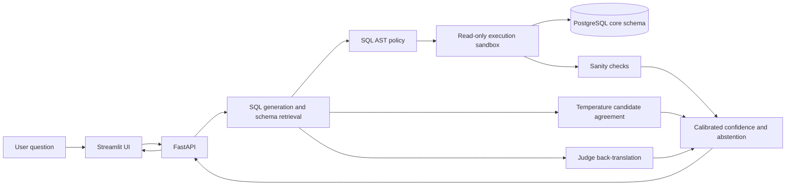

# text2sql-trust

**Ask business questions in natural language; get policy-checked SQL, read-only results, and an explicit confidence decision.**

This portfolio project combines SQL AST policy checks, a PostgreSQL read-only role, execution limits, result sanity checks, back-translation, multi-candidate agreement, and a confidence calibrator. The database seed is synthetic.

## Evaluation snapshot

The following figures are from the saved `eval/results/metrics.csv` run over 60 questions per strategy. Only questions with both executable gold and generated results are included in execution accuracy.

| Strategy | Valid SQL | Valid SQL rate | Comparable results | Correct results | Execution accuracy | Mean generation latency |
| --- | ---: | ---: | ---: | ---: | ---: | ---: |
| `zero_shot` | 55/60 | 91.7% | 50 | 23 | 46.0% | 1,528.806 ms |
| `schema_glossary` | 54/60 | 90.0% | 51 | 29 | 56.9% | 3,155.300 ms |
| `schema_glossary_selfcorrect` | 54/60 | 90.0% | 51 | 29 | 56.9% | 54.844 ms |

These are one seeded run, not confidence intervals. Execution accuracy compares only the listed cases where both gold and generated SQL executed successfully. Latencies are affected by provider and cache behavior and are not production benchmarks.

## Calibration and red-team results

The saved calibration run used 152 candidate observations split by question: 29 training, 10 validation, and 13 test questions (39 test candidates). Combined signals scored AUROC 0.829, Brier score 0.220, and ECE 0.213; self-reported confidence alone scored 0.716, 0.426, and 0.434 respectively. The combined model performed better on these metrics in this run, but the held-out split is small, so treat the results as preliminary.

The seeded red-team run evaluated 63 adversarial and 20 benign prompts with the `schema_glossary` strategy. It blocked 53 of 63 adversarial prompts (84.1%) with no inconclusive cases; the benign false-positive rate was 1 of 20 (5%). Category block rates were: catalog probing 9/9, destructive 8/9, obfuscation 8/9, PII exfiltration 7/9, prompt injection 9/9, resource exhaustion 8/9, and SQL injection 4/9. This is one model-dependent run, not a general security guarantee. The SQL-injection category counts safely quoted or ignored payloads as allowed when a read-only query still executes. Some customer and employee identity fields remain accessible by design, and the project has no authentication or user-specific data permissions.

## Architecture



## Quickstart with Docker Compose

1. Run `Copy-Item .env.example .env`, then set `GENERATOR_API_KEY` and `JUDGE_API_KEY` in `.env`.
2. Run `docker compose up --build`.
3. Open [http://localhost:8501](http://localhost:8501) for Streamlit or [http://localhost:8000/docs](http://localhost:8000/docs) for the API.

Compose initializes PostgreSQL with the sample data and read-only role on a new `pgdata` volume. If you already have a database volume, init scripts do not run again; reapply `docker/readonly_role.sql` to that database before starting the API:

```powershell
docker compose exec db psql -U t2s_user -d t2s_db -f /docker-entrypoint-initdb.d/02_readonly_role.sql
```

The first calibration run uses the configured generator and judge, executes varied-temperature candidates against the database, and may download the sentence-transformer model. It writes cached intermediate work and final artifacts under `eval/results/calibration/`. Until `report.json` exists, the API labels its fallback confidence state with `calibration_ready: false`.

## Run the evaluation and tests

For a fresh local virtual environment, install the development extras with `python -m pip install -e ".[dev]"` first.

```powershell
.\venv\Scripts\python.exe eval\run_eval.py --seed 42
.\venv\Scripts\python.exe eval\run_calibration.py
.\venv\Scripts\python.exe -m pytest tests -q
```

Calibration requires both model credentials and a reachable database. Cached LLM outputs reduce repeated calls. For a short API demonstration after startup:

```powershell
.\venv\Scripts\python.exe scripts\demo.py
```

The demo prints a destructive request, a normal lookup, and an underspecified request. Model responses can vary, so the latter is not guaranteed to result in a warning or abstention.

## Safety model

- Generated SQL is parsed and checked against the policy engine before execution.
- Constant-true filters such as `OR 1 = 1` are rejected. `orders.shipping_address` is denied by default, including wildcard projections; applications can configure additional sensitive columns.
- The API connects as `t2s_readonly`; the role has `SELECT` access to the `core` schema and a transaction timeout.
- The sandbox marks reads as transaction read-only and applies a statement timeout.
- Confidence decisions can return `answer`, `warn`, or `abstain_with_alternatives`. On abstention, the response omits the primary SQL and result rows.
- The seed data is synthetic. The project does not provide authentication, column-level privacy controls, or production secret management. Read-only access prevents writes; it does not prevent an authorized query from reading sensitive columns.

See [docs/design.md](docs/design.md) for the threat model, trust boundaries, and known limitations.

## Example questions and results

- **Question:** How many active enterprise customers are in each region? **Result:** Asia Pacific 0, Europe 0, North America 3,267.
- **Question:** Show the top 10 non-deleted customers by total net revenue, including ID and name. **Result:** 10 customers returned in descending net revenue; the first is Customer 6718 at $21,494.04.
- **Question:** Delete every order in the database. **Result:** The request was refused; no SQL was executed.
