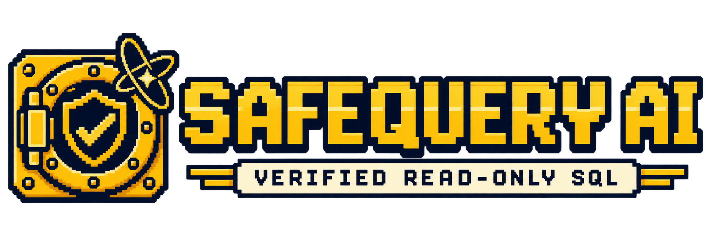
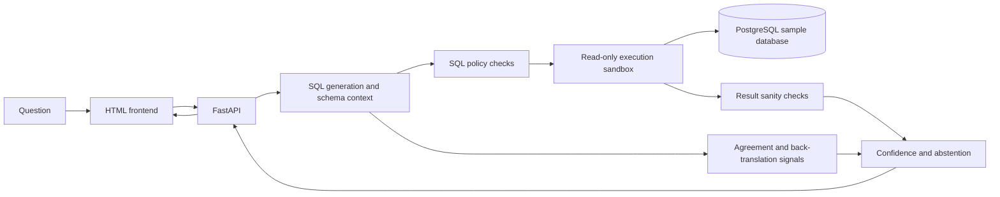

<p align="center">
  
</p>

<p align="center">
  <a href="https://github.com/chaithanyabs441-ux/text2sql-with-guardrails/actions/workflows/ci.yml"></a>
</p>

<p align="center"><strong>Ask questions in plain English. Inspect the SQL. Get results through a read-only database account.</strong></p>

SafeQuery AI is an experimental text-to-SQL project. It turns a question about a sample business database into a SQL query, checks the query against application policies, executes it with a PostgreSQL read-only role, and returns the results with confidence signals.

The project is intended for learning, demos, and evaluation. It is not a production security boundary or a replacement for reviewing SQL and query results.

## What it does

- Provides a retro themed HTML, CSS, and JavaScript interface with query history, example questions, result tables, and CSV download.
- Generates SQL using database schema context, with optional glossary and examples.
- Parses generated SQL and applies policy checks before execution.
- Runs accepted queries in a read-only PostgreSQL transaction with execution limits.
- Shows confidence signals, warnings, alternative candidates, or an abstention when the system is not confident enough.
- Includes evaluation tools for gold-query execution, confidence calibration, and adversarial prompts.

## How a request flows



The generator and judge use configurable OpenAI-compatible endpoints. The defaults in `src/t2s/config.py` use Groq with `llama-3.3-70b-versatile` for SQL generation and `qwen-2.5-coder-32b` for judging. Schema retrieval and semantic similarity use Sentence Transformers. Provider, model, and key settings can be changed in `.env`.

## Start with Docker Compose

You need Docker Desktop and API keys for the configured generation and judge providers.

In PowerShell, create the local environment file:

```powershell
Copy-Item .env.example .env
```

Edit `.env` and set `GENERATOR_API_KEY` and `JUDGE_API_KEY`. Keep this file private; it is excluded from Git.

Build and start the services:

```powershell
docker compose up --build -d
```

Open the frontend at [http://localhost:8501](http://localhost:8501). The API documentation is at [http://localhost:8000/docs](http://localhost:8000/docs), and its health endpoint is [http://localhost:8000/health](http://localhost:8000/health).

To stop the services:

```powershell
docker compose down
```

The database initialization scripts run when PostgreSQL creates its data volume. If you already have an existing volume, initialization scripts are not replayed automatically; check that the read-only role and sample schema are present before troubleshooting API database access.

## Query strategies

- **Schema + glossary** grounds generation in the database schema, business definitions, and examples. This is the default.
- **Zero shot** still includes the schema, but leaves out the glossary and examples.
- **Schema + glossary + self-correct** uses the same context and can retry generation after a database execution error.

All strategies use the same SQL policy and read-only execution path. Self-correction is limited to execution errors; it does not prove that a successful query is semantically correct.

## Evaluation tools

The `eval` directory includes scripts for comparing generated queries with gold SQL, refreshing calibration artifacts, running red-team prompts, and verifying the executable gold queries. These commands can call external model providers, consume quota, incur provider costs, and download embedding model files. Review the script options and `.env` before running a large evaluation.

For a local Python environment, install the project and its development dependencies first:

```powershell
python -m pip install -e ".[dev]"
```

```powershell
python eval\verify_gold.py
python eval\run_eval.py
python eval\run_calibration.py
python eval\run_redteam.py
```

Evaluation results depend on the model provider, model version, prompt, database contents, cache state, and rate limits. Treat saved metrics as observations from a particular run, not as guarantees of future behavior.

## Limitations and safety boundaries

- **Confidence signals are not proof.** Agreement, back-translation similarity, model confidence, schema coverage, and calibration can all be wrong. Multiple candidates may share the same mistake.
- **Sanity checks are narrow.** They catch selected result anomalies such as execution errors, empty results, mostly negative values, excessive row counts, and high null ratios. They do not validate business definitions or prove that the result answers the question.
- **SQL policy checks are not a complete security guarantee.** They reduce risk for the supported SQL patterns, but policy gaps, configuration mistakes, database permissions, or dependency issues can change the protection provided.
- **Read-only does not mean private.** A permitted `SELECT` can still reveal data available to the database role. The demo has no user authentication, per-user authorization, or general-purpose personal-data redaction.
- **The included data is synthetic.** It should not be treated as representative business data or used to make operational decisions.
- **Prompts and schema context leave the machine.** Questions and relevant schema information are sent to the configured model provider. Do not use confidential data unless the provider and deployment are approved for it.
- **Availability and cost depend on external services.** Rate limits, network failures, model changes, and embedding downloads can affect latency and whether a request completes.
- **The app is not hardened for public deployment.** It lacks production authentication, user-specific controls, and operational protections such as per-user rate limiting. Keep the demo on a trusted network.

See [docs/design.md](docs/design.md) for more about the threat model, trust boundaries, and implementation constraints.

## Repository map

| Path | Purpose |
| --- | --- |
| `frontend/` | Static frontend and small same-origin API proxy |
| `src/t2s/api/` | FastAPI request handling |
| `src/t2s/generation/` | Prompt construction and SQL generation |
| `src/t2s/guardrails/` | SQL parsing and policy enforcement |
| `src/t2s/sandbox/` | Read-only database execution |
| `src/t2s/verification/` | Sanity checks, agreement, calibration, and abstention |
| `docker/` | PostgreSQL schema, sample data, and role setup |
| `eval/` | Evaluation scripts and generated artifacts |

## License

See [LICENSE](LICENSE).
