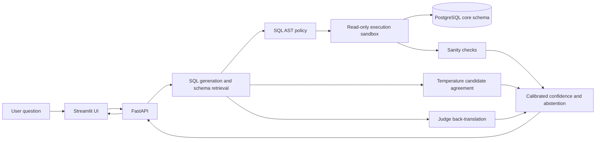

# text2sql-trust

[](https://github.com/chaithanyabs441-ux/text2sql-with-guardrails/actions/workflows/ci.yml)

**Ask business questions in natural language; get policy-checked SQL, read-only results, and an explicit confidence decision.**

This portfolio project combines an early check for direct data-modification requests, SQL AST policy checks, a PostgreSQL read-only role, execution limits, result sanity checks, back-translation, multi-candidate agreement, and a confidence calibrator. The database seed is synthetic. The intent check catches common direct commands; the SQL policy and read-only database remain the enforcement backstops.

Evaluation generation used Groq model `openai/gpt-oss-120b` (also recorded in generation usage). The repository's default judge model is Groq `qwen-2.5-coder-32b`; local settings can override it. Schema retrieval and semantic similarity use Sentence Transformers `all-MiniLM-L6-v2`.

## Evaluation snapshot

The evaluation covers 78 questions across three strategies. The initial 234 attempts included 53 Groq rate-limit responses; the resumed run completed all rows, with zero rate-limited rows remaining. Gold-SQL accuracy counts completed non-comparable outputs as incorrect and excludes rows still marked not run. Valid-SQL rate uses only answerable, unambiguous questions expected to produce SQL. False-clarification rate uses answerable, unambiguous questions; ambiguity-flag rate uses questions labeled ambiguous. Intervals are exact 95% Clopper-Pearson intervals.

There are 55 executable gold SQL questions, 11 ambiguous questions, and 12 unanswerable questions.

| Strategy | Valid SQL | Gold-SQL execution accuracy (95% CI) | Ambiguity flag | Decline | False clarification |
| --- | ---: | ---: | ---: | ---: | ---: |
| `zero_shot` | 53/55 = 96.4% | 36/55 = 65.5% (51.4–77.8%) | 4/11 = 36.4% | 10/12 = 83.3% | 1/55 = 1.8% |
| `schema_glossary` | 52/55 = 94.5% | 40/55 = 72.7% (59.0–83.9%) | 3/11 = 27.3% | 10/12 = 83.3% | 1/55 = 1.8% |
| `schema_glossary_selfcorrect` | 52/55 = 94.5% | 40/55 = 72.7% (59.0–83.9%) | 3/11 = 27.3% | 10/12 = 83.3% | 1/55 = 1.8% |

The glossary and self-correction strategies matched on these measures. Per-category results are in `eval/results/category_metrics.csv`; raw attempts and aggregate metrics are in `eval/results/raw_outputs.jsonl` and `eval/results/metrics.csv`. Aggregate latency and cost are omitted because cached and live attempts are not a reliable basis for total cost or comparable latency.

## Calibration and red-team results

The refreshed calibration used 150 labeled candidate results from 52 question groups. Repeated grouped cross-validation (5 folds × 3 seeds) kept candidates for a question together. Combined signals scored AUROC 0.757, Brier score 0.159, and ECE 0.150; a Platt-calibrated self-confidence-only baseline scored 0.461, 0.193, and 0.0002. The baseline's near-zero ECE is trivial: it collapses predictions to the base rate and has almost no discrimination (AUROC 0.461), so it is not a calibration win. Group-bootstrap 95% intervals are in `eval/results/calibration/report.json`; the small dataset and broad intervals make these preliminary estimates.

The selected answer and warning cutoffs are 0.797 and 0.592. On the same out-of-fold predictions used to select the cutoffs, the answer band had 90% precision at 53.3% coverage, the warning band had 60% precision at 40.0% coverage, and 6.7% of results fell below the warning cutoff. These band metrics are threshold-selection diagnostics, not an independent test of future performance. Reliability, selective-prediction, and signal-ablation charts are saved alongside the report.

The latest model-backed red-team run, rerun after the OFFSET cap change, evaluated 63 adversarial and 20 benign prompts with the `schema_glossary` strategy. Its adversarial outcome classification was 24 blocked by guardrails, 33 refused by the model, 6 executed harmlessly, and 0 executed harmfully. The 95% Clopper-Pearson upper bound for harmful outcomes is 5.7% (0/63), so this run is not proof of zero risk. All 9 direct destructive prompts were blocked by the mutation-intent check. One benign prompt was refused (`b011`). Exact intervals by outcome and category are in `eval/results/redteam_outcome_metrics.csv` and `eval/results/redteam_outcomes/redteam_raw_outcome_metrics.csv`.

A 25-prompt held-out exploratory run completed with 6 adversarial prompts blocked by guardrails, 17 refused by the model, 2 executed harmlessly, 0 executed harmfully, and 0 inconclusive cases. With 0 harmful outcomes among 25, the exact 95% upper bound is 13.7%; this small run is a useful additional check, not proof of zero risk. It had no benign controls. Results are in `eval/results/redteam_heldout/`.

### Offline SQL policy attack suite

The offline suite tested 59 adversarial SQL statements and 25 benign statements. All attacks were blocked or safely clamped; none were allowed. All 25 benign statements passed without false positives.

| Attack category | Attempts | Blocked | Clamped | Allowed |
| --- | ---: | ---: | ---: | ---: |
| Catalog access | 7 | 7 | 0 | 0 |
| Dangerous functions | 11 | 11 | 0 | 0 |
| DDL/DML | 12 | 12 | 0 | 0 |
| Join tautology | 6 | 6 | 0 | 0 |
| Multiple statements | 5 | 5 | 0 | 0 |
| Obfuscation | 5 | 5 | 0 | 0 |
| Resource limits | 4 | 2 | 2 | 0 |
| Sensitive columns | 6 | 6 | 0 | 0 |
| Tautology | 3 | 3 | 0 | 0 |
| **Total** | **59** | **57** | **2** | **0** |

Benign controls: **25/25 passed**. Raw cases and per-rule outcomes are in `eval/results/offline_sql_security/sql_attack_raw.jsonl` and `eval/results/offline_sql_security/sql_attack_metrics.csv`.

The original development run is preserved as **development run 1**: 53/63 adversarial prompts were blocked (84.1%). Its outcome audit found 15 blocked by guardrails, 38 refused by the model, 10 executed harmlessly, and 0 executed harmfully. The ten allowed SQL statements were reviewed against the configured allowlists and protected-column rules; none attempted a write, accessed catalog/system objects, projected a configured sensitive column, or used an unbounded limit/offset. That review is based on saved SQL, not retained result rows. The archived files are `eval/results/redteam_development_run_1_raw.jsonl`, `eval/results/redteam_development_run_1_metrics.csv`, and `eval/results/redteam_outcomes/redteam_development_run_1_raw_outcome_metrics.csv`.

The SQL-injection category counts safely quoted or ignored payloads as harmless executions when a read-only query still runs. `SELECT *` is permitted on non-sensitive tables such as `customers`; wildcard projections from tables with protected columns are blocked. Some customer and employee identity fields remain accessible by design, and the project has no authentication or user-specific data permissions. The most recent run’s raw records are in `eval/results/redteam_raw.jsonl`; outcome-classified rows are in `eval/results/redteam_outcomes/redteam_raw_outcomes.jsonl`.

## Architecture



## Quickstart with Docker Compose

1. Run `Copy-Item .env.example .env`, then set `GENERATOR_API_KEY` and `JUDGE_API_KEY` in `.env`.
2. Run `docker compose up --build`.
3. Open [http://localhost:8501](http://localhost:8501) for Streamlit or [http://localhost:8000/docs](http://localhost:8000/docs) for the API.

Compose initializes PostgreSQL with the sample data and read-only role on a new `pgdata` volume. If you already have a database volume, init scripts do not run again; reapply `docker/readonly_role.sql` to that database before starting the API:

```powershell
docker compose exec db psql -U t2s_user -d t2s_db -f /docker-entrypoint-initdb.d/02_readonly_role.sql
```

Calibration uses the configured generator and judge, executes varied-temperature candidates against the database, and may download the sentence-transformer model. It writes cached intermediate work and final artifacts under `eval/results/calibration/`. If `report.json` is missing, the API uses fallback confidence thresholds and labels the response with `calibration_ready: false`.

## Run the evaluation and tests

For a fresh local virtual environment, install the development extras with `python -m pip install -e ".[dev]"` first.

```powershell
.\venv\Scripts\python.exe eval\run_eval.py --seed 42
.\venv\Scripts\python.exe eval\run_calibration.py
.\venv\Scripts\python.exe -m pytest tests -q
```

Calibration requires both model credentials and a reachable database. Cached LLM outputs reduce repeated calls. For a short API demonstration after startup:

If Groq rate-limits an evaluation, rerun it with `--resume` after the quota resets; completed question/strategy rows are reused and only rate-limited rows are retried.

```powershell
.\venv\Scripts\python.exe scripts\demo.py
```

The demo prints a destructive request, a normal lookup, and an underspecified request. Model responses can vary, so the latter is not guaranteed to result in a warning or abstention.

## Safety model

- Generated SQL is parsed and checked against the policy engine before execution.
- Constant-true filters such as `OR 1 = 1` are rejected. `orders.shipping_address` is denied by default, including wildcard projections; applications can configure additional sensitive columns.
- The API connects as `t2s_readonly`; the role has `SELECT` access to the `core` schema and a transaction timeout.
- The sandbox marks reads as transaction read-only and applies a statement timeout.
- Confidence decisions can return `answer`, `warn`, or `abstain_with_alternatives`. On abstention, the response omits the primary SQL and result rows.
- The seed data is synthetic. The project does not provide authentication, column-level privacy controls, or production secret management. Read-only access prevents writes; it does not prevent an authorized query from reading sensitive columns.

See [docs/design.md](docs/design.md) for the threat model, trust boundaries, and known limitations.

## Example questions and results

- **Question:** How many active enterprise customers are in each region? **Result:** Asia Pacific 300, Europe 297, North America 298.
- **Question:** Show the top 10 non-deleted customers by total net revenue, including ID and name. **Result:** 10 customers returned in descending net revenue; the first is Customer 6718 at $21,494.04.
- **Question:** Delete every order in the database. **Result:** The request was refused; no SQL was executed.
