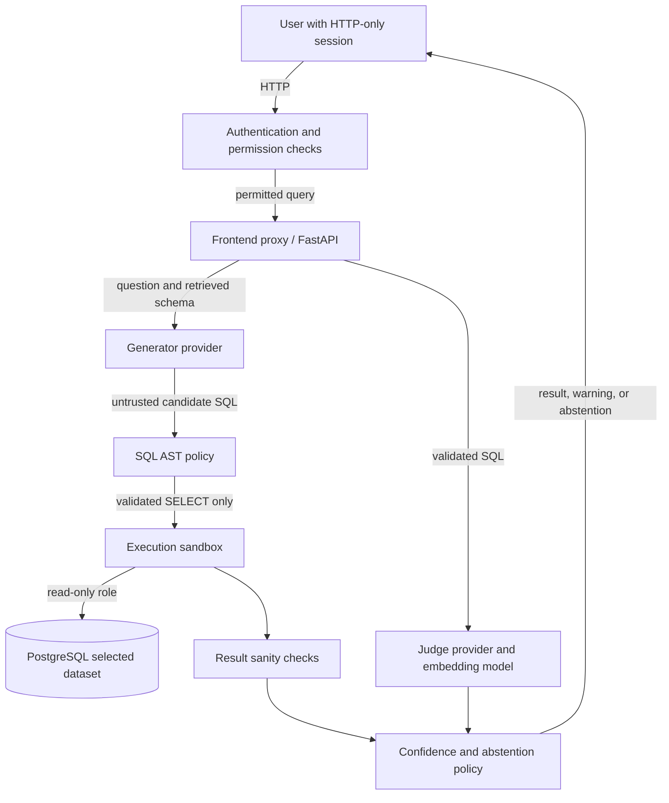

# Design and threat model

## Purpose and protected assets

The service translates a user's natural-language question into a PostgreSQL read query. The main assets are database confidentiality and availability, provider credentials, and the integrity of generated SQL. The included database contains synthetic sample data.

## Trust boundaries

Prompts and model output are untrusted. Provider calls cross an external service boundary. The API
authenticates each user, checks role permissions and dataset grants, and authorizes final SQL table
references before execution. SQL also passes the existing AST policy, and database access uses a distinct
read-only account.

## Threats and controls

| Threat | Control | Remaining limitation |
| --- | --- | --- |
| Destructive SQL or write statements hidden in expressions, CTEs, or multiple statements | AST-wide policy validation and read-only PostgreSQL role | Database privileges and policy configuration must stay aligned |
| Catalog access or unapproved functions | Table and function allowlists | Allowlist mistakes can expose more query capability than intended |
| Unbounded result or expensive query | Row cap, join/subquery limits, database statement timeout | A timeout limits duration, not all resource consumption |
| Model hallucination or prompt injection | Schema grounding, validation, result checks, back-translation, candidate agreement, calibrated answer/warn/abstain decision | LLM signals can be wrong; thresholds depend on the calibration dataset |
| User accesses an ungranted dataset or administrative operation | Server-side session, permission, and core dataset-grant checks | Public file imports are shared with every signed-in account. Imported datasets have no row-level or per-user column policies |
| Sensitive data returned by an allowed SELECT | Global SQL table/function allowlists and sensitive-column checks; synthetic seed data | There is no per-user column policy or general PII redaction. Read-only is not a confidentiality boundary |
| Forged session or role value | Opaque random token with only its SHA-256 digest stored server-side; role comes from the database | Sessions are cookie-based; local Compose uses HTTP and requires Secure cookies to be enabled behind HTTPS |
| Credential exposure | `.env` is ignored by Git and excluded from Docker build context | Local Compose credentials are development defaults, not production secrets |

## Request flow

1. The API authenticates the session, checks the query permission, and requires a grant for `core`. Imported datasets are public to signed-in accounts by design.
2. The API selects schema context and asks the generator for a candidate.
3. The SQL policy parses and validates the candidate; a separate AST check confirms every physical table is allowed by both the granted dataset and the caller's role. Rejected SQL does not reach the executor.
4. The sandbox executes validated SQL in a read-only transaction with a timeout.
5. Three varied-temperature candidates are independently policy-checked, dataset-authorized, and executed to measure result agreement.

For `core`, employee SQL is limited to operational tables while analysts and admins can query every
registered table. Imported datasets allow all signed-in roles to query every imported table. Only admins
can manage users, roles, core grants, and audit logs. The schema view shows the full selected dataset.
6. A judge back-translates the selected SQL. Similarity, agreement, sanity-warning count, self-reported confidence, and table coverage feed the fitted logistic model when its report is available.
7. Validation-split thresholds choose `answer`, `warn`, or `abstain_with_alternatives`. Abstention suppresses the selected SQL and result rows.

## Operational and evaluation limitations

- Authentication and authorization are application-layer controls and have not had an independent security audit. Keep the development Compose deployment on a trusted network.
- Dataset import accepts CSV/XLSX into isolated schemas; it does not connect to arbitrary databases. Imports are shared with all signed-in roles and have no row-level or per-user column grant. Uploaded confidential data should not be used.
- No default administrator is created. A first administrator must be bootstrapped explicitly from temporary environment variables.
- Login is rate limited. Query endpoints do not have per-user request-rate or cost quotas.
- Provider outputs and evaluation accuracy can change with models, prompts, seeds, cache state, and database contents.
- The saved golden-set metrics are a single run. Cached zero token cost is not a live-cost estimate.
- Calibration requires a representative labeled set and should be rerun when generation or schema behavior changes. The report is only considered ready when model coefficients and validation thresholds are both present.
- LLM judge, embedding, and multi-candidate calls add latency and cost. First use may download sentence-transformer weights.
- A blocked generated query is an observed refusal or policy rejection, not proof that every natural-language attack will be blocked.
