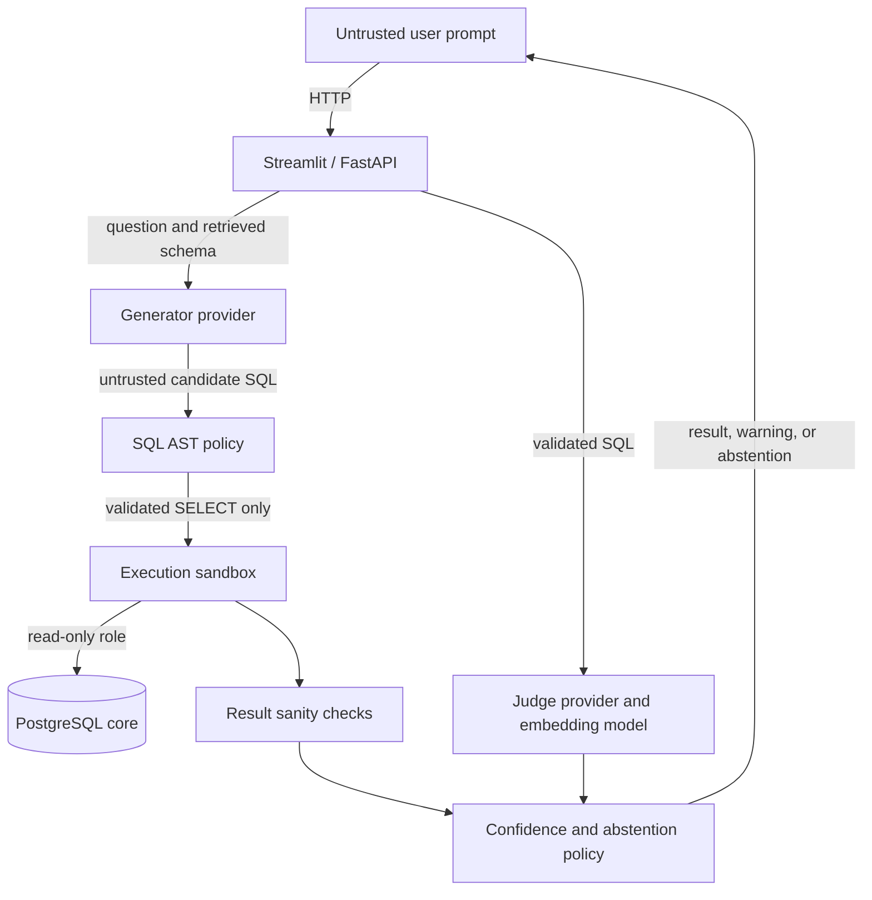

# Design and threat model

## Purpose and protected assets

The service translates a user's natural-language question into a PostgreSQL read query. The main assets are database confidentiality and availability, provider credentials, and the integrity of generated SQL. The included database contains synthetic sample data.

## Trust boundaries

Prompts and model output are untrusted. Provider calls cross an external service boundary. SQL only reaches the database after policy validation, and database access uses a distinct read-only account.

## Threats and controls

| Threat | Control | Remaining limitation |
| --- | --- | --- |
| Destructive SQL or write statements hidden in expressions, CTEs, or multiple statements | AST-wide policy validation and read-only PostgreSQL role | Database privileges and policy configuration must stay aligned |
| Catalog access or unapproved functions | Table and function allowlists | Allowlist mistakes can expose more query capability than intended |
| Unbounded result or expensive query | Row cap, join/subquery limits, database statement timeout | A timeout limits duration, not all resource consumption |
| Model hallucination or prompt injection | Schema grounding, validation, result checks, back-translation, candidate agreement, calibrated answer/warn/abstain decision | LLM signals can be wrong; thresholds depend on the calibration dataset |
| Sensitive data returned by an allowed SELECT | Synthetic seed data and controlled schema | There is no authentication, column-level access policy, or PII redaction. Read-only is not a confidentiality boundary between users |
| Credential exposure | `.env` is ignored by Git and excluded from Docker build context | Local Compose credentials are development defaults, not production secrets |

## Request flow

1. The API selects schema context and asks the generator for a candidate.
2. The policy engine parses and validates that candidate. Rejected SQL does not reach the executor.
3. The sandbox executes validated SQL in a read-only transaction with a timeout.
4. Three varied-temperature candidates are independently policy-checked and executed to measure result agreement.
5. A judge back-translates the selected SQL. Similarity, agreement, sanity-warning count, self-reported confidence, and table coverage feed the fitted logistic model when its report is available.
6. Validation-split thresholds choose `answer`, `warn`, or `abstain_with_alternatives`. Abstention suppresses the selected SQL and result rows.

## Operational and evaluation limitations

- The project has no authentication or per-user rate limiting. Do not expose the development Compose deployment to the public internet.
- Provider outputs and evaluation accuracy can change with models, prompts, seeds, cache state, and database contents.
- The saved golden-set metrics are a single run. Cached zero token cost is not a live-cost estimate.
- Calibration requires a representative labeled set and should be rerun when generation or schema behavior changes. The report is only considered ready when model coefficients and validation thresholds are both present.
- LLM judge, embedding, and multi-candidate calls add latency and cost. First use may download sentence-transformer weights.
- A blocked generated query is an observed refusal or policy rejection, not proof that every natural-language attack will be blocked.
